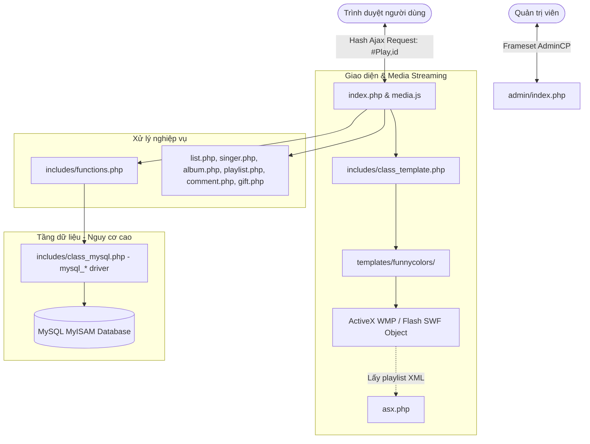
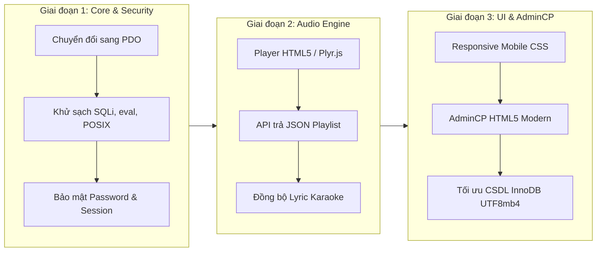

# Báo Cáo Nghiên Cứu, Đánh Giá Và Phương Án Nâng Cấp Hệ Thống XtreMedia

> **Dự án**: XtreMedia (Phiên bản phân tích: 1.2)  
> **Tác giả gốc**: RedPhoenix89 (Khoảng năm 2006 - 2008)  
> **Ngôn ngữ & Môi trường gốc**: PHP 4 / 5.2, MySQL 4/5 (MyISAM), Internet Explorer 6/7/ActiveX / Adobe Flash  
> **Bản quyền & Mục đích phân tích**: Nghiên cứu kiến trúc, khắc phục lỗ hổng an toàn thông tin và hiện đại hóa hệ thống.

---

## 1. Tổng Quan Kiến Trúc Dự Án

**XtreMedia** từng là một trong những CMS cổng âm nhạc (Music Portal Script) phổ biến nhất tại Việt Nam thập niên 2000. Hệ thống cung cấp giải pháp trọn gói cho phép quản trị và phát nhạc trực tuyến với các tính năng:
- **Nghe nhạc đơn & playlist**: Nghe theo bài hát, theo ca sĩ, theo album, playlist cá nhân thành viên.
- **Tương tác cộng đồng**: Bình luận bài hát (hỗ trợ Yahoo Emoticons), quà tặng âm nhạc qua email (Gift Card), danh sách thành viên.
- **Xếp hạng & Thống kê**: Top Play, Top Download (theo tháng & toàn thời gian), bộ đếm truy cập, người dùng online theo thời gian thực.
- **Admin Control Panel (AdminCP)**: Quản lý Media (thêm đơn, thêm nhanh theo danh sách, sửa hàng loạt), quản lý ca sĩ/album/thể loại mẹ-con, phân quyền Admin/Mod, sao lưu database, cấu hình máy chủ media.

### Sơ đồ kiến trúc hiện tại (Legacy Architecture):



---

## 2. Phân Tích Chi Tiết Ưu Điểm & Nhược Điểm

### 2.1. Ưu Điểm (Strengths)

1. **Tư duy SPA (Single Page Application) đi trước thời đại**:
   - Từ năm 2006–2007, khi hầu hết website tải lại toàn bộ trang (full-page reload), XtreMedia đã triển khai cơ chế điều hướng SPA thông qua URL Hash (`#Home`, `#Play,123`, `#Singer,5`) và Ajax polling để nghe nhạc liên tục không bị ngắt quãng khi người dùng chuyển trang.
2. **Hệ thống tính năng âm nhạc rất thực tế và đầy đủ**:
   - Phân cấp ca sĩ (Việt Nam, Quốc tế), Album, danh mục đa cấp (parent/sub categories).
   - Tích hợp lời bài hát (Lyric), tự động chuyển đổi tiếng Việt có dấu sang không dấu (`utf8_to_ascii`) phục vụ tìm kiếm.
   - Tính năng "Tặng nhạc qua Email" cực kỳ phù hợp thị hiếu người dùng thời kỳ Blog 360 & Yahoo! Messenger.
   - Cơ chế báo link hỏng (Broken link reporting) giúp người quản trị lọc và sửa nhanh bài hát lỗi.
3. **Template Engine tách biệt**:
   - Mã nguồn đã có ý thức tách biệt giữa tầng Logic (PHP) và tầng View (HTML), sử dụng cú pháp placeholder như `{TPL_LINK}`, `{song.TITLE}`, các khối lặp `<!-- BEGIN list_row --> ... <!-- END list_row -->`.
4. **Nhẹ, độc lập, triển khai đơn giản**:
   - Không phụ thuộc vào bất kỳ thư viện hay package cồng kềnh nào bên thứ ba (zero external dependencies).

---

### 2.2. Nhược Điểm & Lỗ Hổng Nghiêm Trọng (Weaknesses & Vulnerabilities)

#### A. Không Thể Chạy Trên PHP Hiện Đại (PHP 7.x / 8.x Incompatible)

| Thành phần lỗi | Mã nguồn hiện tại | Nguyên nhân & Hậu quả trên PHP 7/8 |
| :--- | :--- | :--- |
| **Driver MySQL** | `mysql_connect()`, `mysql_query()` trong [class_mysql.php](file:///d:/Download/xtremedia/includes/class_mysql.php) | Đã bị **loại bỏ hoàn toàn** từ PHP 7.0. Gây lỗi `Fatal error: Call to undefined function mysql_connect()`. |
| **Hàm POSIX Regex** | `ereg()`, `eregi()` trong [functions.php](file:///d:/Download/xtremedia/includes/functions.php#L519-L525) | Đã bị **loại bỏ** từ PHP 7.0. Khiến các hàm kiểm tra email, validate chuỗi văng lỗi Fatal error. |
| **Hàm cắt chuỗi split** | `split(',', $url)` trong [index.php](file:///d:/Download/xtremedia/index.php#L43) | Bị loại bỏ từ PHP 7.0. Điều hướng hash bị gãy hoàn toàn. |
| **Modifier `/e` trong Regex** | `preg_replace('...#se', ...)` trong [class_template.php](file:///d:/Download/xtremedia/includes/class_template.php#L22) | Modifier `/e` (eval) bị gỡ bỏ từ PHP 7.0 vì nguy cơ an ninh nghiêm trọng. Template engine bị crash. |
| **Gán đối tượng tham chiếu** | `$tpl =& new Template;` | Cú pháp `=& new` bị loại bỏ trên PHP 7+. |
| **Biến môi trường cũ** | `$HTTP_GET_VARS`, `register_globals` extraction trong [config.php](file:///d:/Download/xtremedia/includes/config.php#L17-L23) | Các mảng này không còn tồn tại trên PHP hiện đại. |

#### B. Trình Phát Nhạc Hoàn Toàn Lỗi Thời (Obsolete Media Players)

- File [mp3.html](file:///d:/Download/xtremedia/templates/funnycolors/players/mp3.html) và [wmv.html](file:///d:/Download/xtremedia/templates/funnycolors/players/wmv.html) sử dụng ActiveX Control của **Windows Media Player** (`CLSID:6BF52A52-394A-11D3-B153-00C04F79FAA6`).
- File [swf.html](file:///d:/Download/xtremedia/templates/funnycolors/players/swf.html) sử dụng **Adobe Flash Player**.
- File [asx.php](file:///d:/Download/xtremedia/asx.php) sinh file XML Playlist dạng Windows Media Metafile.
> ⚠️ **Hậu quả**: Tất cả các trình duyệt hiện đại (Chrome, Edge, Firefox, Safari) trên cả máy tính lẫn điện thoại đều đã ngừng hỗ trợ Flash và ActiveX từ nhiều năm trước. **Hiện tại người dùng không thể phát nhạc trên bất kỳ trình duyệt nào!**

#### C. Lỗ Hổng Bảo Mật Cực Kỳ Nghiêm Trọng (Critical Security Holes)

1. **SQL Injection Bypass Đăng nhập AdminCP**:
   - File [admin/login.php](file:///d:/Download/xtremedia/admin/login.php#L7):
     ```php
     $name = $_POST['name'];
     $q = $mysql->query("SELECT user_id FROM ".$tb_prefix."user WHERE user_name = '".$name."' AND user_password = '".$password."' AND (user_level = 2 OR user_level = 3)");
     ```
     -> Kẻ tấn công chỉ cần nhập username: `admin' -- ` với bất kỳ mật khẩu nào là có thể **đăng nhập quyền quản trị tối cao** mà không cần biết mật khẩu!
   - Tương tự, các module tìm kiếm, comment, thêm/sửa bài hát đều nối chuỗi trực tiếp mà không escape dữ liệu.

2. **Variable Overwrite (Ô nhiễm biến toàn cục)**:
   - File [config.php](file:///d:/Download/xtremedia/includes/config.php#L21-L22):
     ```php
     extract($_GET);
     extract($_POST);
     ```
     -> Cho phép người dùng truyền bất kỳ tham số nào trên URL để ghi đè biến nội bộ (ví dụ: `?isLoggedIn=1`, `?tb_prefix=malicious_`, `?mainURL=evil.com`).

3. **Remote Code Execution (RCE) qua `eval()`**:
   - File [class_form.php](file:///d:/Download/xtremedia/includes/class_form.php#L109) & [media_song.php](file:///d:/Download/xtremedia/admin/media_song.php#L109):
     ```php
     eval('$mysql->query("'.$sql.'");');
     ```
     -> Việc thực thi `eval()` trực tiếp trên chuỗi SQL do form sinh ra cho phép kẻ tấn công chèn mã PHP độc hại để chiếm quyền kiểm soát máy chủ.

4. **Lưu trữ mật khẩu yếu & Cơ chế Quên mật khẩu hớ hênh**:
   - Mật khẩu chỉ băm bằng `md5()` không salt mạnh, dễ dàng bị tra cứu ngược trên các cơ sở dữ liệu rainbow table.
   - Cơ chế quên mật khẩu trong [user.php](file:///d:/Download/xtremedia/user.php#L66): Tạo mật khẩu mới và lưu thẳng vào cột `user_new_password` dưới dạng **văn bản thuần (plain text)**.

5. **Lỗi logic làm hỏng toàn bộ Playlist**:
   - File [playlist.php](file:///d:/Download/xtremedia/playlist.php#L44):
     ```php
     $mysql->query("UPDATE ".$tb_prefix."playlist SET playlist_contents = CONCAT('".$add_id.",',playlist_contents)");
     ```
     -> Thiếu mệnh đề `WHERE playlist_id = '...'`! Khi một người dùng thêm bài hát, **tất cả playlist của toàn bộ người dùng trong hệ thống đều bị ghi đè bài hát đó**!

6. **Giao diện không tương thích thiết bị di động**:
   - Trang chủ cố định chiều rộng `770px`, layout dạng Table lồng nhau cổ điển.
   - AdminCP sử dụng thẻ `<frameset>`, `<frame>` (đã bị loại bỏ trong HTML5 standard).

---

## 3. Các Phương Án Nâng Cấp Tối Ưu

Tùy theo mục tiêu sản phẩm, chúng tôi đề xuất 3 phương án nâng cấp rõ ràng:

### Bảng So Sánh 3 Phương Án

| Tiêu chí | Phương án 1: Retro Remaster (Bảo tồn & Nâng cấp PHP 8) | Phương án 2: Tái cấu trúc lai (Pragmatic Modernization - Khuyên Dùng) | Phương án 3: Viết lại toàn diện (Full-Stack Decoupled) |
| :--- | :--- | :--- | :--- |
| **Mục tiêu** | Chạy được trên PHP 8+, giữ nguyên 100% diện mạo và style 2007 | Giữ bản sắc cổ điển nhưng hiện đại hóa Player HTML5, an toàn bảo mật, Responsive Mobile | Xây dựng nền tảng nhạc số quy mô lớn chuẩn thương mại |
| **Backend** | PHP 8.2/8.3, PDO Native | PHP 8.2/8.3, Cấu trúc MVC gọn, PDO Prepared Statements | Laravel 11 / NestJS / Go RESTful API |
| **Frontend** | Giữ skin FunnyColors + CSS nâng cấp, HTML5 Audio Player | FunnyColors Responsive (Flex/Grid) + APlayer / Plyr.js | Next.js / React 19 / Vue 3 SPA |
| **Player** | HTML5 Audio cơ bản | HTML5 Audio hiện đại, hỗ trợ lyric karaoke LRC, wave preview | Web Audio API, HLS Audio Streaming (m3u8), DRM |
| **Thời gian triển khai**| **1 - 2 ngày** | **3 - 5 ngày** | **3 - 4 tuần** |
| **Độ phức tạp** | Thấp | Trung bình | Cao |
| **Khả năng thương mại** | Thấp (chủ yếu lưu niệm/retro) | Khá (vận hành trang web cộng đồng ổn định) | Rất cao |

---

## 4. Chi Tiết Lộ Trình Phương Án 2: Pragmatic Modernization (Khuyên Dùng)

Phương án này cân bằng hoàn hảo giữa việc **bảo tồn nét đẹp hoài niệm thập niên 2000** của XtreMedia và **đạt chuẩn kỹ thuật công nghệ năm 2026**.



### Bước 1: Thay thế tầng Database & Khắc phục tương thích PHP 8+
- Viết lại [class_mysql.php](file:///d:/Download/xtremedia/includes/class_mysql.php) thành `Database` class sử dụng **PHP Data Objects (PDO)**.
- Áp dụng Prepared Statements cho 100% câu lệnh truy vấn.
- Thay thế triệt để:
  - `split()` $\rightarrow$ `explode()`
  - `ereg()` / `eregi()` $\rightarrow$ `preg_match()`
  - `preg_replace(...#se)` $\rightarrow$ `preg_replace_callback()`
  - `extract($_GET); extract($_POST);` $\rightarrow$ Xóa bỏ hoàn toàn, đọc dữ liệu chặt chẽ qua helper `filter_input()` hoặc wrapper an toàn.
  - Sửa bug `UPDATE media_playlist` bằng cách thêm điều kiện `WHERE playlist_id = :pid`.

### Bước 2: Nâng cấp Trình phát nhạc (Audio Player)
- Thay thế hoàn toàn thẻ `<OBJECT>` Windows Media Player và Flash bằng thư viện HTML5 Audio hiện đại (như **APlayer** hoặc **Plyr**):
  - Tương thích 100% với iOS Safari, Android Chrome, Windows, macOS.
  - Hỗ trợ thanh Seekbar, điều chỉnh âm lượng, hiển thị ảnh bìa Album/Ca sĩ.
  - Tự động chuyển bài tiếp theo trong Playlist/Album.
  - Hỗ trợ hiển thị lời bài hát (Lyric) cuộn mượt mà.
- Thay thế [asx.php](file:///d:/Download/xtremedia/asx.php) bằng endpoint API trả về JSON chuẩn cho audio player:
  ```json
  [
    {
      "name": "Bài hát demo",
      "artist": "Tên ca sĩ",
      "url": "https://server.com/media/song.mp3",
      "cover": "templates/funnycolors/img/no_album.gif",
      "lrc": "[00:00.00] Lời bài hát..."
    }
  ]
  ```

### Bước 3: Nâng cấp Cơ sở dữ liệu & Quản lý người dùng
- Chuyển toàn bộ bảng từ `ENGINE=MyISAM` sang `ENGINE=InnoDB` để hỗ trợ transactions và khóa cấp dòng (row-level locking).
- Chuyển bảng mã từ `latin1`/`utf8` cũ sang `utf8mb4` để hiển thị tiếng Việt và emoji hoàn hảo.
- Chuyển `user_password` sang chuẩn mã hóa an toàn: `password_hash($pwd, PASSWORD_ARGON2ID)` hoặc `PASSWORD_BCRYPT`.
- Xóa bỏ việc lưu mật khẩu thô trong `user_new_password`. Cơ chế reset mật khẩu chuyển sang dạng Token có thời hạn xác thực qua link gửi email.
- Thêm `CSRF Token` cho tất cả các form gửi dữ liệu (Đăng ký, Đăng nhập, Bình luận, AdminCP).

### Bước 4: Tinh chỉnh Giao diện (Responsive Retro UI)
- Giữ nguyên màu sắc và phong cách thiết kế đặc trưng của `funnycolors` (hoài niệm thời Yahoo! 360, WareZones).
- Sử dụng CSS Flexbox/Grid hiện đại thay cho layout dạng Table cứng `770px`, giúp co giãn hiển thị đẹp mắt trên màn hình điện thoại thông minh và tablet.
- Loại bỏ `<frameset>` trong AdminCP, thay bằng giao diện quản trị 1 trang với Navigation Sidebar cố định, bảng dữ liệu phân trang Ajax sạch đẹp.

---

## 5. Kết Luận & Đề Xuất Bước Kế Tiếp

Dự án **XtreMedia 1.2** là một di sản mã nguồn quý giá của cộng đồng lập trình web Việt Nam, sở hữu tư duy thiết kế tính năng rất phong phú và đi trước thời đại. Tuy nhiên, sau gần 2 thập kỷ, hệ sinh thái web đã thay đổi toàn diện khiến mã nguồn không thể vận hành được trên môi trường hiện đại nếu chưa được nâng cấp.

**Đề xuất hành động**:  
1. Nếu bạn muốn **phục hồi và bảo tồn** dự án để có thể chạy mượt mà trên hosting/XAMPP hiện nay (PHP 8.2+): Chúng ta nên triển khai ngay **Phương án 2 (Pragmatic Modernization)**.
2. Nếu bạn muốn **phát triển một trang web nghe nhạc thương mại mới**: Chúng ta nên tận dụng luồng nghiệp vụ của XtreMedia và dựng lại theo **Phương án 3 (Laravel/NestJS + Next.js)**.
