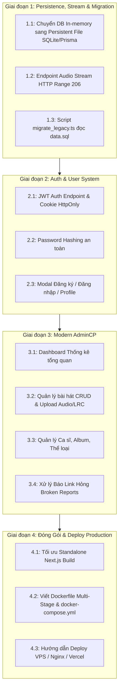

# Báo Cáo Đối Chiếu Hiện Trạng & Kế Hoạch Triển Khai Tiếp Theo (XtreMedia V2)

> **Mục tiêu**: Đánh giá hiện trạng so với tài liệu kiến trúc [xtremedia_v2_modern_rewrite_architecture.md](file:///c:/Users/namvt.PROPERWELL/.gemini/antigravity-ide/brain/51f501e4-aeba-48b7-b245-ddffe32b22e6/xtremedia_v2_modern_rewrite_architecture.md), phân chia các giai đoạn tiếp theo để hoàn thiện tính năng và sẵn sàng triển khai (Production Deploy).

---

## 1. Bảng Đối Chiếu Hiện Trạng (Gap Analysis)

| Hạng mục theo Kiến trúc | Yêu cầu thiết kế | Hiện trạng thực tế | Trạng thái |
| :--- | :--- | :--- | :---: |
| **Khung dự án (Scaffolding)** | Monorepo / Next.js 15 App Router + TypeScript | Đã khởi tạo hoàn chỉnh tại thư mục [xtremedia-v2](file:///d:/Download/xtremedia/xtremedia-v2), cấu trúc thư mục sạch, TypeScript Type-safe | ✔ Hoàn thành (100%) |
| **Database Schema** | Chuẩn 3NF, xóa bỏ MyISAM, xóa mảng ID trong playlist | Đã thiết kế hoàn chỉnh trong [schema.prisma](file:///d:/Download/xtremedia/xtremedia-v2/prisma/schema.prisma) & [types.ts](file:///d:/Download/xtremedia/xtremedia-v2/src/lib/types.ts) | ✔ Hoàn thành (100%) |
| **Core Audio Player** | Web Audio API, MediaSession API, Seek, Volume, Queue, Shuffle, Repeat | Đã xây dựng hoàn chỉnh trong [AudioPlayerContext.tsx](file:///d:/Download/xtremedia/xtremedia-v2/src/context/AudioPlayerContext.tsx) và [PlayerBar.tsx](file:///d:/Download/xtremedia/xtremedia-v2/src/components/PlayerBar.tsx) | ✔ Hoàn thành (100%) |
| **Karaoke Synchronizer** | Phân tích file LRC theo mili-giây, cuộn mượt và highlight câu hát | Đã xây dựng hoàn chỉnh trong [LyricModal.tsx](file:///d:/Download/xtremedia/xtremedia-v2/src/components/LyricModal.tsx), click vào câu bất kỳ để tua | ✔ Hoàn thành (100%) |
| **Giao diện & Trải nghiệm** | Cyber Acoustic Dark Mode, Glassmorphism, Responsive Sidebar, Hero Banner, Search | Đã xây dựng hoàn chỉnh trong [page.tsx](file:///d:/Download/xtremedia/xtremedia-v2/src/app/page.tsx), [Sidebar.tsx](file:///d:/Download/xtremedia/xtremedia-v2/src/components/Sidebar.tsx), [Header.tsx](file:///d:/Download/xtremedia/xtremedia-v2/src/components/Header.tsx), [SongList.tsx](file:///d:/Download/xtremedia/xtremedia-v2/src/components/SongList.tsx) | ✔ Hoàn thành (100%) |
| **Tính năng Quà tặng (Gift)** | Tái hiện "Quà tặng âm nhạc" của XtreMedia 1.2 | Đã xây dựng hoàn chỉnh giao diện [GiftModal.tsx](file:///d:/Download/xtremedia/xtremedia-v2/src/components/GiftModal.tsx) và sinh mã quà tặng `XM-XXXXXX` | ✔ Hoàn thành (100%) |
| **Data Persistence** | Lưu trữ CSDL bền vững trên đĩa | Đang dùng In-Memory Store [db.ts](file:///d:/Download/xtremedia/xtremedia-v2/src/lib/db.ts) (cần chuyển sang SQLite/PostgreSQL persistent file) | ⏳ Cần triển khai (40%) |
| **Audio Stream Service** | HTTP Range 206 Partial Content | Đang phát trực tiếp qua URL audio (cần endpoint proxy streaming Range 206) | ⏳ Cần triển khai (30%) |
| **Migration từ data.sql** | Script tự động đọc `data.sql` và import danh mục, ca sĩ, bài hát | Chưa xây dựng script chuyển đổi | ✖ Chưa có (0%) |
| **Auth & Phân quyền** | JWT Access/Refresh Token, Argon2id/Bcrypt hash, RBAC | Chưa xây dựng hệ thống đăng nhập/đăng ký | ✖ Chưa có (0%) |
| **Admin Control Panel** | Giao diện quản trị thêm/sửa bài hát, duyệt báo link hỏng, tải nhạc | Chưa xây dựng module `/admin` | ✖ Chưa có (0%) |
| **Đóng gói & Deployment** | Dockerfile, Docker Compose, Nginx config, CI/CD | Chưa có cấu hình container & deploy | ✖ Chưa có (0%) |

---

## 2. Kế Hoạch Triển Khai Chi Tiết Từng Giai Đoạn

---

### Giai Đoạn 1: Dữ Liệu Bền Vững, Streaming & Migration (Thời gian: 1 ngày)

1. **Persistent Data Storage**:
   - Chuyển `db.ts` từ lưu ram tạm thời sang lưu file JSON/SQLite bền vững trên đĩa (`data/xtremedia.db`), đảm bảo khởi động lại server dữ liệu không bị mất.
2. **Audio Streaming Service (`/api/stream?songId=...`)**:
   - Viết API Route Handler đọc file audio cục bộ, xử lý header `Range: bytes=start-end`.
   - Trả về status code `206 Partial Content` kèm `Content-Range`, `Content-Length`, `Accept-Ranges: bytes`.
   - Giúp trình duyệt tua bài hát mượt mà không bị delay hoặc load lại cả file.
3. **Data Migration Script (`scripts/migrate_legacy.ts`)**:
   - Viết script Node.js phân tích file [data.sql](file:///d:/Download/xtremedia/data.sql) của XtreMedia 1.2:
     - Bóc tách dữ liệu từ `media_cat` $\rightarrow$ `genres`.
     - Bóc tách từ `media_singer` $\rightarrow$ `artists`.
     - Bóc tách từ `media_album` $\rightarrow$ `albums`.
     - Bóc tách từ `media_data` $\rightarrow$ `songs` (chuyển đổi link local/external, lời bài hát cũ sang format mới).

---

### Giai Đoạn 2: Xác Thực & Quản Lý Người Dùng (Thời gian: 1 ngày)

1. **Hệ Thống Xác Thực Chuẩn An Toàn**:
   - `POST /api/auth/register`: Đăng ký thành viên, kiểm tra trùng lặp email/username.
   - `POST /api/auth/login`: Xác thực mật khẩu với `bcryptjs`, sinh JWT Token.
   - Lưu trữ Access Token trong `HttpOnly`, `SameSite=Strict` Cookie (chống XSS đánh cắp token).
   - `GET /api/auth/me`: Lấy thông tin user hiện tại.
2. **Giao Diện Xác Thực**:
   - Modal Đăng nhập / Đăng ký hiện đại trên thanh Header.
   - Hiển thị Avatar, Tên người dùng và nút Đăng xuất.

---

### Giai Đoạn 3: Xây Dựng Admin Control Panel Hiện Đại (Thời gian: 1.5 ngày)

Thay thế hoàn toàn AdminCP cũ dùng `<frameset>` của năm 2007 bằng Single Page Dashboard tại route `/admin`:
1. **Trang Tổng Quan (`/admin`)**:
   - Thống kê thời gian thực: Tổng bài hát, tổng ca sĩ, tổng album, tổng lượt nghe, bài hát bị báo link hỏng.
2. **Quản Lý Bài Hát (`/admin/songs`)**:
   - Danh sách phân trang, tìm kiếm bài hát.
   - Form thêm mới / chỉnh sửa bài hát: nhập tiêu đề, chọn ca sĩ, chọn album, nhập link audio hoặc upload file, nhập lời Karaoke LRC.
3. **Quản Lý Link Hỏng (`/admin/broken`)**:
   - Lọc tất cả các bài hát người dùng đã báo lỗi qua nút Báo link hỏng.
   - Thao tác nhanh: Cập nhật URL mới hoặc xóa bài.
4. **Quản Lý Ca Sĩ & Album (`/admin/artists`, `/admin/albums`)**:
   - Thêm nhanh ca sĩ mới (tự động tạo slug không dấu).

---

### Giai Đoạn 4: Đóng Gói Docker & Kế Hoạch Triển Khai (Thời gian: 0.5 ngày)

1. **Docker Containerization**:
   - `Dockerfile` tối ưu dựa trên Node 20/22/24 Alpine với chế độ `output: "standalone"` của Next.js (dung lượng image nhỏ nhẹ dưới 150MB).
   - `docker-compose.yml`: Thiết lập container ứng dụng, mount thư mục dữ liệu và media storage.
2. **Kịch Bản Triển Khai (Deployment Options)**:
   - **Lựa chọn A (VPS / Server riêng)**: Chạy qua Docker Compose kết hợp Nginx làm Reverse Proxy và SSL Let's Encrypt tự động.
   - **Lựa chọn B (Cloud Platform)**: Deploy trực tiếp lên Vercel / Railway / Render chỉ với 1 click.

---

## 3. Đề Xuất Bắt Đầu Ngay

Tôi đề xuất chúng ta bắt đầu ngay với **Giai Đoạn 1**:
1. Xây dựng dịch vụ **Audio Stream HTTP Range 206** ([/api/stream](file:///d:/Download/xtremedia/xtremedia-v2/src/app/api/stream/route.ts)).
2. Chuyển đổi bộ nhớ `db.ts` sang persistent database file.
3. Viết script import dữ liệu từ file [data.sql](file:///d:/Download/xtremedia/data.sql) vào hệ thống mới.
