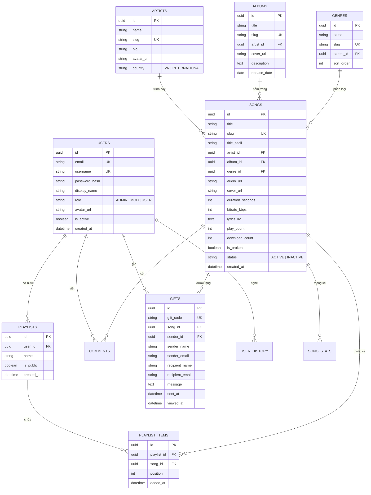
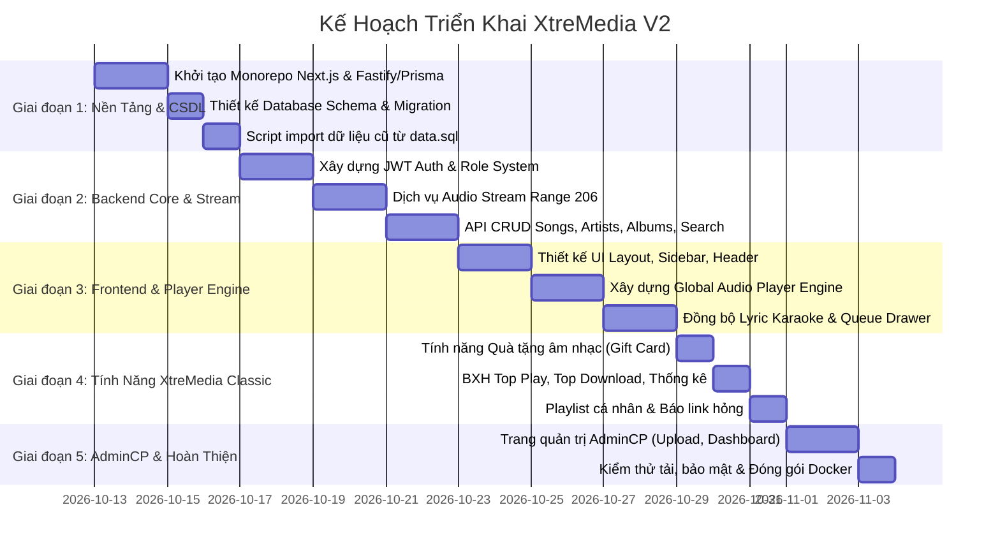

# Thiết Kế Kiến Trúc & Kế Hoạch Viết Lại Toàn Diện XtreMedia V2

> **Định hướng**: Viết lại toàn diện (Full-Stack Decoupled / Modern Monorepo)  
> **Mục tiêu**: Xây dựng nền tảng phát nhạc trực tuyến chuẩn công nghiệp, bảo mật cao, giao diện đẳng cấp, chịu tải tốt, tương thích 100% thiết bị hiện đại (Desktop, Tablet, Mobile).

---

## 1. Công Nghệ Đề Xuất (Modern Tech Stack)

Dựa trên môi trường thực tế của hệ thống (đã có sẵn **Node.js v24.15** và **npm v11.12**):

```mermaid
graph TD
    subgraph Client [Tầng Khách Hàng (Client Layer)]
        Web[Next.js 15 / React 19 SPA & PWA]
        Mobile[Responsive Mobile Web & MediaSession API]
    end

    subgraph AudioEngine [Tầng Xử Lý Âm Thanh]
        Howler[Howler.js / Web Audio API]
        LRC[Lyric Parser & Sync Highlighter]
        Wavesurfer[Wavesurfer.js Sóng Âm Thanh]
    end

    subgraph BackendAPI [Tầng Dịch Vụ Backend (API Layer)]
        Gateway[Hono / Fastify / Next.js Server Actions]
        AuthService[Auth Service: JWT + Argon2id]
        MediaService[Media Streaming Service: HTTP 206 Partial Content]
        AdminService[Admin Management Engine]
    end

    subgraph DataStorage [Tầng Lưu Trữ & Dữ Liệu]
        DB[(PostgreSQL / MySQL 8 với Prisma ORM)]
        Cache[(Redis Cache: Top Play, Session, Rate Limit)]
        Storage[(Cloudflare R2 / AWS S3 / Local Media Storage)]
    end

    Client --> BackendAPI
    Web --> AudioEngine
    BackendAPI --> DataStorage
```

### Chi tiết Stack công nghệ:
1. **Frontend**:
   - **Framework**: **Next.js 15 (App Router)** hoặc **Vite + React 19**.
   - **Styling**: Vanilla CSS Modules hoặc Tailwind CSS với hệ thống Design Tokens (Dark Mode mặc định, Glassmorphism, Accent Vibrant Indigo/Violet).
   - **Audio Player**: Tích hợp **Web Audio API** / **Howler.js** kết hợp **MediaSession API** (cho phép người dùng tạm dừng/chuyển bài trực tiếp từ thanh thông báo điện thoại, bàn phím đa phương tiện, tai nghe Bluetooth).
   - **Karaoke Sync**: Trình biên dịch định dạng **LRC (Synchronized Lyrics)** hiển thị lời chạy từng dòng/từng từ theo mili-giây.

2. **Backend**:
   - **Runtime**: **Node.js v24 LTS** / TypeScript.
   - **Framework**: **Fastify / Hono** (hiệu năng cực cao) hoặc **Next.js Route Handlers** (nếu triển khai Monorepo gọn nhẹ).
   - **ORM**: **Prisma ORM** hoặc **Drizzle ORM** (kiểm soát kiểu dữ liệu an toàn - Type-Safe, chống 100% SQL Injection).
   - **Authentication**: Chuẩn **JWT (Access Token 15m + Refresh Token 7d)** lưu trong `HttpOnly`, `SameSite=Strict` Cookie; mật khẩu băm bằng thuật toán **Argon2id**.

3. **Media Streaming & Lưu trữ**:
   - Máy chủ hỗ trợ chuẩn **HTTP Range Requests (Status 206 Partial Content)** giúp trình duyệt tua bài hát tức thì mà không cần tải toàn bộ file.
   - Lưu trữ media hỗ trợ cả Local Storage an toàn lẫn Cloud Object Storage (Cloudflare R2 không tốn phí băng thông tải ra / AWS S3).

---

## 2. Thiết Kế Cơ Sở Dữ Liệu Hiện Đại (Database Schema - 3NF)

Khắc phục triệt để các hạn chế của cơ sở dữ liệu cũ (xóa bỏ kiểu dữ liệu `MyISAM`, loại bỏ lưu mảng ID bằng dấu phẩy trong `playlist_contents`, hỗ trợ Unicode chuẩn `utf8mb4`):



---

## 3. Đặc Tả API Chuẩn RESTful (API Endpoints)

| Module | Method | Endpoint | Mô tả |
| :--- | :--- | :--- | :--- |
| **Auth** | `POST` | `/api/v1/auth/register` | Đăng ký tài khoản (xác thực email, validate chuẩn) |
| | `POST` | `/api/v1/auth/login` | Đăng nhập trả về JWT Access Token & Refresh Token |
| | `POST` | `/api/v1/auth/refresh` | Làm mới Access Token qua Cookie HttpOnly |
| | `GET` | `/api/v1/auth/me` | Lấy thông tin người dùng hiện tại |
| **Songs** | `GET` | `/api/v1/songs` | Lấy danh sách bài hát (hỗ trợ phân trang, lọc genre, sort) |
| | `GET` | `/api/v1/songs/:id-or-slug`| Chi tiết bài hát + lời nhạc + ca sĩ liên quan |
| | `GET` | `/api/v1/songs/:id/stream`| Stream âm thanh (Hỗ trợ HTTP Range 206 Partial Content) |
| | `POST` | `/api/v1/songs/:id/listen`| Ghi nhận lượt nghe hợp lệ (chống spam reload) |
| | `POST` | `/api/v1/songs/:id/report-broken`| Báo link hỏng |
| **Ranking**| `GET` | `/api/v1/rankings/top-plays`| BXH Top Play (Realtime, Tuần, Tháng, Toàn thời gian) |
| | `GET` | `/api/v1/rankings/top-downloads`| BXH Top Download |
| **Search** | `GET` | `/api/v1/search?q=...` | Tìm kiếm bài hát, ca sĩ, album (hỗ trợ tiếng Việt không dấu) |
| **Playlists**| `GET` | `/api/v1/playlists/me` | Lấy danh sách playlist của người dùng |
| | `POST` | `/api/v1/playlists/:id/items` | Thêm bài hát vào playlist (sắp xếp vị trí) |
| | `DELETE`| `/api/v1/playlists/:id/items/:songId`| Xóa bài hát khỏi playlist |
| **Gifts** | `POST` | `/api/v1/gifts` | Tạo quà tặng âm nhạc và gửi email thông báo |
| | `GET` | `/api/v1/gifts/:code` | Nhận và mở quà tặng âm nhạc |
| **Admin** | `GET/POST`| `/api/v1/admin/songs` | CRUD bài hát + upload file âm thanh trực tiếp |
| | `GET` | `/api/v1/admin/broken-reports`| Quản lý các bài hát báo lỗi |

---

## 4. Thiết Kế Trải Nghiệm Giao Diện Người Dùng (UI/UX Design)

### 4.1. Phong cách thiết kế: "Retro-Modern Cyber Acoustic"
- **Color Palette**:
  - Background chính: `#0B0E14` (Deep Space Dark).
  - Surface/Card: `#141A23` với border viền mờ `rgba(255, 255, 255, 0.08)`.
  - Accent Color: `#6366F1` (Indigo Neon) kết hợp `#EC4899` (Pink Pulse) gợi nhớ nét trẻ trung thời kỳ XtreMedia nhưng cực kỳ sang trọng.
  - Text: `#F8FAFC` (Primary White), `#94A3B8` (Secondary Slate).
- **Trình phát nhạc Floating Player (Cố định đáy màn hình)**:
  - Hiển thị bài hát đang phát, ảnh thumbnail đĩa xoay vinyl tinh tế.
  - Controls: Nút Play/Pause, Next, Prev, Shuffle, Repeat, Thanh tiến trình Seekbar mượt mà, Volume slider.
  - Nút bật/tắt cửa sổ lời bài hát **Full Screen Karaoke Modal** (hiệu ứng mờ nền Blur Glassmorphism).
  - Nút mở danh sách hàng đợi phát nhạc (Play Queue).

---

## 5. Lộ Trình Triển Khai Chi Tiết (Sprint Breakdown)



---

## 6. Kế Hoạch Di Chuyển Dữ Liệu (Data Migration từ `data.sql`)

Chúng ta sẽ cung cấp script `migrate_legacy_data.ts` tự động chuyển đổi toàn bộ dữ liệu từ tệp [data.sql](file:///d:/Download/xtremedia/data.sql) hiện có:
1. Đọc và làm sạch cấu trúc bảng `media_data`, `media_singer`, `media_album`, `media_cat`.
2. Chuẩn hóa tên ca sĩ, tự động sinh slug tiếng Việt không dấu (`utf8_to_ascii`).
3. Chuyển đổi các bài hát `m_url` nội bộ và link ngoài sang bảng `songs`.
4. Chuyển đổi `media_user` sang bảng `users` với cờ `needs_password_reset = true` (do hash MD5 cũ không còn an toàn).
